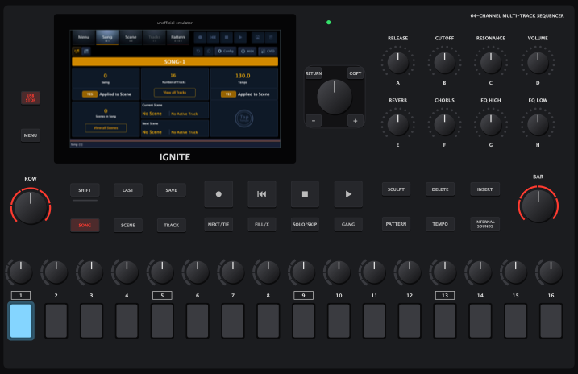
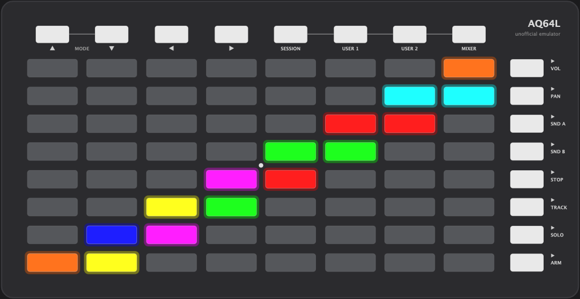
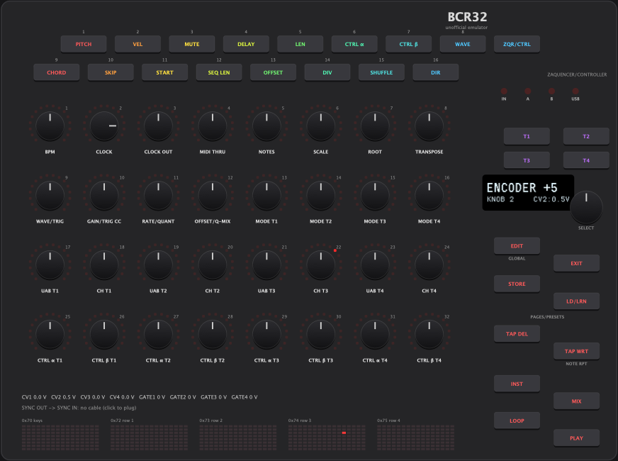

# behringer-desktop-emulators

Run the firmware Behringer open-sourced for three of its controllers on your Mac, each with an emulated panel you can click and script:

| Device | Behringer's source | What runs |
| --- | --- | --- |
| **IGNITE** sequencer | [0716-AAF](https://github.com/MusicTribeOpenSource/0716-AAF) | Behringer's IGNITE app, lightly patched, talking to an emulated front panel over the panel's own serial protocol. The app's screen is shown inside the panel, and touch works. |
| **AQ64L** pad controller | [0715-AAX](https://github.com/MusicTribeOpenSource/0715-AAX) | The demo firmware, compiled for the desktop, with its USB MIDI ports as virtual MIDI ports. |
| **BCR32** controller | [0715-AAW](https://github.com/MusicTribeOpenSource/0715-AAW) | The demo firmware, compiled for the desktop: OLED, LED rings, knobs, CV/gate, SYNC, and USB and DIN MIDI as virtual ports. |

> **Unofficial.** This project is not made, endorsed or supported by Behringer or Music Tribe. Behringer, IGNITE, AQ64L and BCR32 are their trademarks, used here only to say which hardware is emulated. No Behringer code is in this repository: `emu` fetches it from Behringer's public repositories when you build.



<p>


</p>

## Quick start

You need macOS (tested on Apple Silicon), Xcode's command-line tools, CMake 3.22+, git and Python 3.

```sh
./emu run aq64l       # or bcr32, or ignite
```

The first run fetches Behringer's source and JUCE 7.0.12 and builds. That takes a minute or two for the AQ64L and BCR32, and several minutes for the IGNITE app. Later runs start in seconds. Other commands:

```sh
./emu run bcr32 --detach    # leave it running and return
./emu status
./emu stop                  # all runs, or: ./emu stop bcr32
./emu midi list             # the MIDI ports the emulators made (see "Talking MIDI")
```

All three can run at the same time. `--firmware PATH|URL` builds from your own checkout or fork of Behringer's repository, and `--ref BRANCH` picks a branch. For the IGNITE, `--app PATH` uses an IGNITE app you built yourself (with `ignite/patches` applied). Builds live in `~/.cache/behringer-desktop-emulators` (set `EMU_CACHE` to change that). `EMU_JUCE=/path/to/JUCE` uses a JUCE checkout you already have.

**On the panels:** click a key or pad to press it; it stays down while you hold the mouse button. Alt-click latches a key, so you can hold two at once. Drag a knob up or down, or scroll over it, to turn it, and click a knob without moving to push it. When a unit is asked to enter its bootloader, the panel says so; click to switch it off and on again.

## Talking MIDI

The AQ64L and BCR32 show up to any MIDI software on the Mac as the hardware would, as virtual CoreMIDI ports:

| Emulator | Ports |
| --- | --- |
| AQ64L | `AQ64L DAW Control` (USB cable 0), `AQ64L User MIDI` (cable 1) |
| BCR32 | `BCR-32 CTRL` (USB cable 0), `BCR-32 ZAQ` (cable 1), `BCR-32 MIDI IN`, `BCR-32 MIDI OUT A`, `BCR-32 MIDI OUT B` (the DIN jacks) |

`emu midi` (tools/midiprobe) plays the host side from a script:

```sh
./emu midi send "AQ64L DAW" 90 24 10                       # light the bottom-left pad red
./emu midi ask "AQ64L DAW" 1 F0 00 20 32 00 01 6D 7F 00 F7  # product info; prints the reply
./emu midi listen "BCR-32 CTRL" 5                          # print what the BCR32 sends for 5 s
```

What each demo firmware does with MIDI is Behringer's code, unchanged:
- **AQ64L:** pads send notes 36–99 (36 at the bottom left), the top keys CC 104–111, and the right-hand keys CC 112–119. Notes from the host light the pads, with the velocity picking the colour.
- **BCR32:** the demo echoes every USB packet back, answers the mode query `F0 00 20 32 7F 64 74 F7`, and passes MIDI IN through to both DIN outputs.

## Scripting

`tools/emu_ctl` drives a running emulator, for tests and screenshots. Name the device first when more than one is running.

```sh
tools/emu_ctl aq64l press PAD 1 1        # PAD X Y: X from the left, Y from the bottom
tools/emu_ctl aq64l lit                  # which LEDs are on, and their colours
tools/emu_ctl bcr32 turn KNOB 3 4        # detents, + is clockwise; SELECT is the encoder by the OLED
tools/emu_ctl bcr32 press T1
tools/emu_ctl bcr32 oled                 # the OLED as text (or: oled out.png)
tools/emu_ctl bcr32 cv                   # CV and gate outputs
tools/emu_ctl bcr32 cable on             # plug a cable from SYNC OUT to SYNC IN
tools/emu_ctl ignite press SONG
tools/emu_ctl ignite turn A 5            # knobs A-H, ENC 1-16, JOG, ROW, BAR
tools/emu_ctl ignite touch 512 109       # a touch on the app's screen (screen pixels)
tools/emu_ctl ignite screenshot out.png  # the app's screen
tools/emu_ctl DEVICE shot panel.png 0.8  # the whole panel
tools/emu_ctl DEVICE list                # every control name
```

## How it works

### IGNITE

The IGNITE's app runs on a Linux board and talks to a microcontroller that scans the panel. The emulator plays that microcontroller.

- **The link.** Messages go over a serial port in their own format, `[header E0..E8][direction][id][size][payload]`, with no checksum.
  - The panel announces itself (`E0 01 A9`), and the app answers and asks for its version (`A3`, `A8`).
  - Keys go as a 12-byte bitmap, streamed while a key is held, because the app counts frames to tell a hold.
  - Encoders go as steps, at most one message per encoder every 100 ms, with fast codes for big turns.
  - The app sends back a 16-row LED matrix (keys, encoder collars, the blue LEDs under the pads), pad colours and knob ring levels.
  - `ignite/panel/Link.cpp` speaks the panel's side, over a pty.
- **`ignite/patches/0001-desktop-front-panel-port.patch`** makes the app read its panel from the serial port or pty named by `IGNITE_FP_TTY` on macOS. It also stops two threads that otherwise spin with nothing to read, which kept the optimised build from running. With the variable unset it does nothing, and the device build is unchanged.
- **`ignite/patches/0002-screen-mirror.patch`** adds a screen mirror, taken from the KICK firmware. With `IGNITE_SCREEN_MIRROR=<unix socket>`, the app renders its window headless and serves the screen as RFB ("VNC") on that socket, and pointer events come back as touches. `ignite/panel/ScreenView.cpp` shows it in the panel's display cut-out.
- **A sound font.** The app needs one (`/tmp/Ignite.sf2` on macOS), and the real one is not in Behringer's release, so `emu` writes a silent one if there is none.

Verified against the app:
- the handshake;
- keys and their lights;
- pad colours;
- touch;
- jog and ROW turns.

Knobs A–H and the step encoders send the same message format; they act on the track pages. The sequencer does not play yet on macOS, because the app has no macOS clock. [PR #8 on 0716-AAF](https://github.com/MusicTribeOpenSource/0716-AAF/pull/8) adds one.

### AQ64L and BCR32

Both demo firmwares are bare-metal C: a `main()` with a loop, over a thin hardware layer. The emulator compiles Behringer's application files unchanged and puts a desktop version of that hardware layer underneath (`aq64l/shim`, `bcr32/shim`). The firmware's `main()` runs on its own thread, and the GigaDevice library and USB stack are not used.

- **AQ64L.** `Template/main.c` and `Demo/midi_demo.c` run against:
  - the 80 RGB LEDs (`rgb.h`);
  - the 9×9 key matrix (`button.h`);
  - the USB MIDI class (`usb_midi.h`);
  - the flash mailbox and reset the bootloader request uses.
- **BCR32.** The application (`App/`: input, CV, SysEx, activity LEDs, SYNC loopback, MIDI thru, SPI flash test) and the SSD1306 driver run against an emulated board (`demo/Board`):
  - The 74HC165 chain, with the buttons as bits and the encoders as quadrature gray codes, so the firmware's own decoder counts the turns.
  - The five HT16K33 LED drivers.
  - An SSD1306 controller model that receives the driver's command and data bytes, with addressing modes and remapping.
  - The SPI flash, held in memory.
  - The CV DAC and the gates.
  - The DIN and USB MIDI ports.
  - The 1 kHz SysTick.
  - The SYNC jacks, with an optional loopback cable.

What is not emulated or not known:
- **The bootloaders are not emulated.** A bootloader request stops the firmware, and the panel says so.
- **The BCR32's internal flash self test does not run.** It reads flash at a fixed address and times itself with the CPU's cycle counter.
- **Some BCR32 mapping is assumed.** Behringer's sources document buttons 1–16, T1–T4 (18–21) and the SELECT push (24). The other keys' button ids, the order of the LEDs in each knob ring, and which LED driver bits light the keys are not published. `emu_ctl bcr32 list` marks those guesses "(assumed)", the panel draws every LED driver's raw RAM along the bottom, and `BTN n` presses any button id. The demo's LED walk at power-on shows which outputs exist.

## Prior art

Others have worked on these devices too:
- [christian-schneider's PRs on 0716-AAF](https://github.com/MusicTribeOpenSource/0716-AAF/pull/8) run the IGNITE desktop build on macOS (with a sequencer clock) and add a click-to-press key simulator ([#9](https://github.com/MusicTribeOpenSource/0716-AAF/pull/9)).
- [chillbeast/0716-AAF](https://github.com/chillbeast/0716-AAF) (`desktop-build`) is a Windows IGNITE simulator with its faceplate built into the app.
- [hmnibu_Ignite](https://github.com/hellomynameisbenjaminupton/hmnibu_Ignite) is a browser mock of the IGNITE panel.
- [Issue #1 on 0715-AAW](https://github.com/MusicTribeOpenSource/0715-AAW/issues/1) documents the stock BCR32 firmware's MIDI.

This project's approach is to run Behringer's own code unchanged against an emulated panel that speaks the hardware's protocol. It follows the [KickEmulator](https://github.com/KickEm-Tools/KickEmulator) for Behringer's KICK.

## Licence

AGPL-3.0-or-later, like Behringer's sources and the KickEmulator this borrows from.
- `ignite/panel/ScreenView.*` comes from the KickEmulator, under the AGPL with its original header.
- The screen mirror in `ignite/patches/0002` comes from the KICK firmware (KickEm-Tools/0700-AAM), also under the AGPL with its original header.
- The shim headers repeat the function names of Behringer's driver interfaces so that their application code compiles against them.
