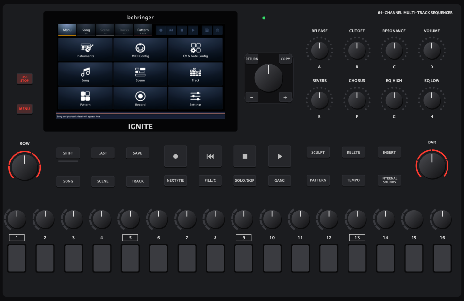

# IgniteEmulator

A desktop front panel for Behringer's IGNITE sequencer app ([MusicTribeOpenSource/0716-AAF](https://github.com/MusicTribeOpenSource/0716-AAF)). It runs the IGNITE's own app on your computer and gives it a panel to talk to: the 16 step pads and their encoders, knobs A–H, the jog, ROW and BAR, and every key, with the lights the app sends back. The app's screen is shown inside the panel, and touching it works.

It is built like the [KickEmulator](https://github.com/KickEm-Tools/KickEmulator) for the KICK, and borrows from it: the screen mirror and its viewer, and the idea of a scripted panel for tests. The IGNITE's link to its panel is its own protocol, not the KICK's, so the panel side is new.



Status: macOS (Apple Silicon), fast mode only (the app built for the desktop). Verified against the app:
- the handshake;
- keys and their lights (SONG, SCENE, TRACK, PATTERN, MENU and the rest);
- pad colours;
- touch on the screen;
- jog and ROW turns.

Knobs A–H and the step encoders send the same message format; they act on the track pages.

## Quick start

Needs Xcode's command-line tools, CMake 3.22+, git and Python 3.

```sh
./ignitem run          # fetch 0716-AAF, apply patches/, build the app and the panel, start both
```

The first run builds Behringer's app (several minutes) and downloads JUCE 7.0.12. Later runs start in seconds. `--app PATH` uses an IGNITE app you built yourself (with the patches applied); `--firmware PATH` uses a local checkout instead of fetching.

On the panel, click a key or pad to press it (it stays down while the mouse button is held), drag or scroll a knob to turn it, and click a knob without moving to push it. Click on the screen as you would touch it.

## How it works

- **The link.** The IGNITE app talks to its front-panel microcontroller over a serial port in its own format: `[header E0..E8][direction][id][size][payload]`, with no checksum.
  - The panel announces itself (`E0 01 A9`), the app answers and asks its version (`A3`, `A8`).
  - Then keys go as a 12-byte bitmap, streamed while a key is held, since the app counts frames to tell a hold.
  - Encoders go as steps, at most one message per encoder per 100 ms, with fast codes for big turns.
  - The app sends back a 16-row LED matrix (keys, encoder collars, the blue LEDs under the pads), pad colours and knob ring levels.
  - `panel/Link.cpp` speaks the panel's side, over a pty.
- **`patches/0001-desktop-front-panel-port.patch`**: the app reads its panel from the serial port or pty named by `IGNITE_FP_TTY` on the desktop (macOS). It also stops two threads that otherwise spin with nothing to read, which also stopped the optimised build from running. Inert when the variable is not set; the device build is unchanged.
- **`patches/0002-screen-mirror.patch`**: the KICK firmware's screen mirror, taken over. With `IGNITE_SCREEN_MIRROR=<unix socket>` the app's window has no native window; it renders headless and serves its screen as RFB ("VNC") on that socket, and pointer events come back as touches. `panel/ScreenView.cpp` (from the KickEmulator) shows it in the panel's display cut-out.
- **A sound font.** The app needs one (`/tmp/Ignite.sf2` on macOS) and the real one is not in Behringer's release; `ignitem` writes a silent one if there is none.

## Scripting

`tools/ignitem_ctl` drives a running emulator, for tests and screenshots:

```sh
tools/ignitem_ctl press SONG            # a key, pad or knob push (held 120 ms, or press NAME MS)
tools/ignitem_ctl down "PAD 3"; tools/ignitem_ctl up "PAD 3"
tools/ignitem_ctl turn A 5              # knobs A-H, ENC 1-16, JOG, ROW, BAR; signed detents
tools/ignitem_ctl touch 512 109         # a touch on the app's screen (screen pixels)
tools/ignitem_ctl screenshot out.png    # the app's screen
tools/ignitem_ctl shot panel.png 0.8    # the whole panel
tools/ignitem_ctl lit                   # what is lit: keys, collars, pad colours, knob rings
tools/ignitem_ctl list | link
```

## Licence

AGPL-3.0-or-later, as Behringer's IGNITE source and the KickEmulator it borrows from. `panel/ScreenView.*` comes from the KickEmulator; the screen mirror in `patches/0002` comes from the KICK firmware (KickEm-Tools/0700-AAM), both under the AGPL with their original headers.
